# Clinical AI Shadow-Mode Monitoring Platform
## Detailed Architecture, Governance Framework & Operational Blueprint

> **Companion Executive Brief:** [2-Page Executive Summary](./summary.md)  
> **Authoritative Evaluation Criteria & Benchmarks:** [Evaluation Metrics Explorer — AI Health Solution Evaluations](https://catch-evals.s3.ap-south-1.amazonaws.com/Evaluation_Metrics_Explorer.html)  
> **Scope:** Comprehensive technical, clinical, governance, privacy, and operational blueprint for hosting multi-centric healthcare AI shadow-mode pilots in India.  
> **Visual Disclaimer:** All diagrams, dashboard mockups, and animations in this document are representative illustrations; any numeric metrics, scores, or case figures depicted are dummy/illustrative data points only.

---

## Table of Contents

1. [Strategic Context, Problem Statement & Objectives](#1-strategic-context-problem-statement--objectives)
2. [Platform Operating Model & Stakeholder Architecture](#2-platform-operating-model--stakeholder-architecture)
3. [End-to-End Pilot Lifecycle & Pre-Deployment Readiness Gate](#3-end-to-end-pilot-lifecycle--pre-deployment-readiness-gate)
4. [The 5-Pillar Monitoring Framework & Criteria Governance](#4-the-5-pillar-monitoring-framework--criteria-governance)
5. [Passive Shadow-Mode Execution & Cross-Check Reconciliation Mechanism](#5-passive-shadow-mode-execution--cross-check-reconciliation-mechanism)
6. [Reference System Architecture & Telemetry Hook Specification](#6-reference-system-architecture--telemetry-hook-specification)
7. [Real-Time Monitoring, Drift Detection & Scheduled Executive Reporting](#7-real-time-monitoring-drift-detection--scheduled-executive-reporting)
8. [End-of-Pilot Governance, Scale-Up Playbook & Remediation Loop](#8-end-of-pilot-governance-scale-up-playbook--remediation-loop)
9. [Regulatory Alignment (India), Risk Register & Phased Implementation Roadmap](#9-regulatory-alignment-india-risk-register--phased-implementation-roadmap)

---

## 1. Strategic Context, Problem Statement & Objectives

### 1.1 Why Traditional Multi-Centric Data Collection Fails in India
Healthcare AI models developed on single-institution or non-Indian cohorts frequently underperform when deployed across India's diverse care delivery settings. Historically, teams attempted to bridge this gap by building centralized multi-centric training and validation data lakes. In practice, centralized pooling encounters severe structural friction in India:

| Barrier Dimension | Ground Reality in Indian Healthcare | Consequence for AI Adoption |
| :--- | :--- | :--- |
| **Privacy & Legal Risk** | Digital Personal Data Protection (DPDP) Act 2023 obligations, hospital fear of patient data leakage, and institutional sensitivity over clinical datasets. | Hospitals block outbound transfers of raw EHR, imaging scans, or pathology slides. |
| **Multi-Site Ethics Bottlenecks** | Independent Institutional Ethics Committees (IEC/IRB) per hospital with non-uniform review procedures for external data sharing. | 9–18 month delays before a single record is shared; frequent pilot abandonment. |
| **Infrastructure & Device Heterogeneity** | Coexistence of enterprise HIS/PACS in Tier-1 metros, custom EMRs in Tier-2 cities, and mixed paper-digital workflows with legacy hardware in Tier-3 districts. | Static retrospective archives fail to reflect real-world acquisition noise, encoding quirks, and workflow realities. |
| **Static vs. Live Clinical Reality** | Retrospective evaluations miss live inference latency, network drops, clinician alert burden, and seasonal or equipment-driven distribution shifts. | Solutions that validate well on static archives fail operationally within weeks of deployment. |

### 1.2 Why Isolated Single-Center Pilots Are Sub-Optimal
Faced with the friction of multi-centric data pooling, hospitals and AI developers routinely fall back to **isolated, single-center pilots**. While faster to start at one institution, single-center pilots are structurally insufficient for proving real-world clinical readiness or enabling scaled adoption across India:

| Limitation Dimension | Why Single-Center Pilots Fall Short | Strategic Consequence |
| :--- | :--- | :--- |
| **Inability to Measure True Clinical & Operational Gains** | A single hospital reflects one baseline standard of care, one local disease prevalence, and one staffing profile (e.g., an elite Tier-1 sub-specialist team vs. an overburdened Tier-3 clinic). Incremental diagnostic yield, turnaround time savings, and economic ROI measured at one center cannot reliably predict gains elsewhere. | Overstates or understates real-world value; fails to give hospital boards or public health payers credible ROI proof for network scale-up. |
| **Blindness to Data, Demographic & Hardware Variability** | One institution exposes the AI to a narrow geographic/socioeconomic cohort, a single HIS/EMR/PACS vendor, standardized local protocols, and a limited set of imaging/lab device OEMs. | Masks domain shift, scanner calibration sensitivity, coding discrepancies, and subgroup equity gaps—causing models that "passed" locally to degrade abruptly at the next hospital. |
| **Excessive Time & Resource Burn ("Pilotitis")** | Every isolated pilot forces hospital clinicians, IT teams, ethics committees, and AI startups to repeatedly rebuild evaluation criteria, data connectors, adjudication tools, and executive reporting from scratch—running **sequentially** (site-by-site) rather than in parallel. | Stretches credible multi-site validation across 2–4 years, exhausts scarce clinical/engineering bandwidth, and drains startup capital without reaching scaled deployment. |
| **Non-Comparable, Non-Reusable Evidence** | Without shared Stage-0 governance criteria and standardized telemetry hooks, each site evaluates ad-hoc endpoints with varying adjudication rigor. | Hospital B cannot trust or reuse Hospital A's pilot dossier—forcing redundant re-piloting before every procurement decision and stalling CDSCO/regulatory evidence building. |

### 1.3 The Shadow-Mode Monitoring Paradigm Shift
This platform resolves **both** failure modes simultaneously—achieving parallel multi-centric breadth *without* raw data centralization, and shared governance rigor *without* single-center duplication. Instead of exporting patient data out of hospitals, **AI solutions deploy directly inside multiple diverse hospitals concurrently within isolated shadow sandboxes**, while **only de-identified telemetry, structured metrics, and concordance signals flow to a central monitoring platform.**

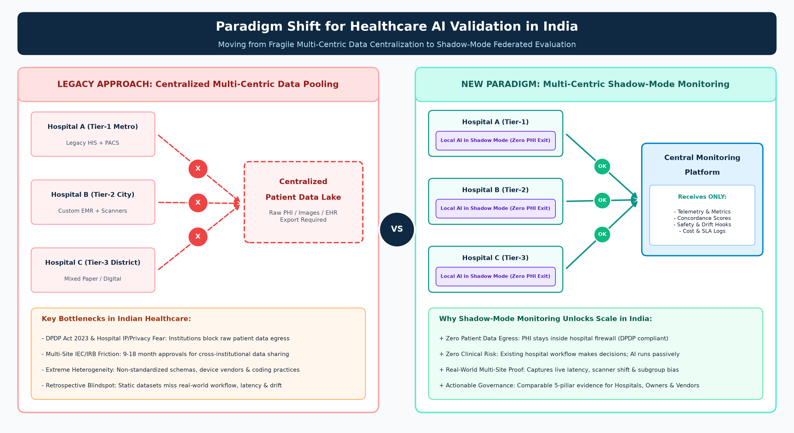

### 1.4 Core Platform Objectives
1. **Zero-Risk Prospective Clinical Validation:** Enable hospitals to evaluate candidate AI tools on live clinical workloads over multiple months with **zero direct impact on patient diagnosis or treatment**.
2. **Standardized, Independent Benchmarking:** Anchor every pilot to versioned, Platform Owner–governed criteria published in the **[Evaluation Metrics Explorer](https://catch-evals.s3.ap-south-1.amazonaws.com/Evaluation_Metrics_Explorer.html)** across five holistic pillars.
3. **Privacy-by-Design Telemetry:** Enforce strict local patient data residency inside hospital firewalls; transmit only cryptographically pseudonymized telemetry and operational hooks compliant with India's DPDP Act 2023.
4. **Continuous Real-Time Oversight & Executive Transparency:** Detect model drift, hardware calibration shifts, operational anomalies, and safety signals in real time, paired with automated scheduled executive reports.
5. **Dual-Sided Actionable Outcomes:** Equip hospitals and governance bodies with objective **Go / Conditional-Go / No-Go** scale-up dossiers while supplying AI developers with granular failure-mode diagnostics to strengthen model generalizability.

---

## 2. Platform Operating Model & Stakeholder Architecture

The platform operates as a **three-sided governed clinical ecosystem**, anchored by an independent multidisciplinary governance council.

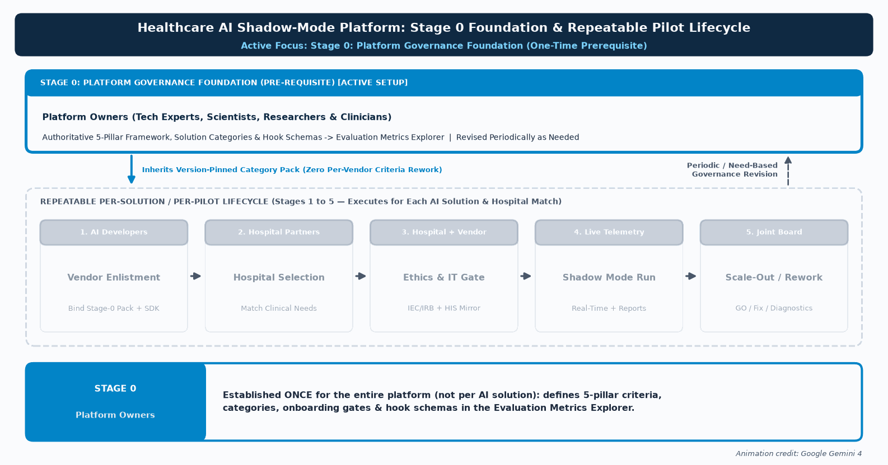  
*Animation credit: Google Gemini 4*

### 2.1 Platform Owners (Multidisciplinary Governance Council)
*Composition:* Technology Architects, AI Scientists, Biostatisticians, Clinical Researchers, Patient Safety Officers, and Domain Clinicians.

**Core Mandate:**
- **Framework & Criteria Stewardship:** Author, version, and maintain the complete evaluation framework—including solution categories, One-Time Onboarding Gates, Ongoing Monitoring metrics, formulas, target thresholds, and justifications—in the **[Evaluation Metrics Explorer](https://catch-evals.s3.ap-south-1.amazonaws.com/Evaluation_Metrics_Explorer.html)**.
- **Catalog Gatekeeping:** Vet AI solutions prior to platform listing (verifying completion of One-Time Onboarding Gates, container security posture, telemetry hook conformance, and prerequisite completeness).
- **Independent Audit & Certification:** Monitor active multi-site shadow pilots for blinding integrity, protocol adherence, and evidence rigor; co-sign final scale-up dossiers.

### 2.2 Healthcare AI Solution Developers (Vendors / Research Teams)
**Core Mandate:**
- **Enlistment & Prerequisite Transparency:** Sign up on the platform, classify their solution into the appropriate category, declare all hospital deployment prerequisites (compute/hardware, HIS/PACS/LIS interfaces, security requirements, IEC/IRB protocol templates), and submit One-Time Onboarding documentation (Payload 0 / Package A).
- **Mandatory Telemetry Hook Compliance:** Instrument their inference runtime with the **Platform Telemetry Hook SDK** (or conformant webhook API) and contractually agree to emit all ongoing metrics mandated by the Platform Owners for their solution category.
- **Active Remediation:** Respond to platform-generated drift, operational, or safety alerts during multi-month pilots via version-controlled updates.

### 2.3 Hospitals & Clinical Institutions (Multi-Centric Pilot Network)
**Core Mandate:**
- **Need-Driven Discovery & Selection:** Browse approved catalog listings and select AI solutions aligned with local clinical priorities, patient case mix, and IT readiness.
- **Joint Pre-Deployment Execution:** Collaborate with the selected AI developer to fulfill all institutional prerequisites—including local IEC/IRB ethics approval, DPDP privacy sign-off, read-only clinical data mirroring, and blinded adjudication panel setup.
- **Shadow Operations & Feedback:** Maintain clinical standard of care strictly decoupled from AI outputs, supply confirmed ground-truth linkage and structured user feedback, and participate in monthly governance reviews and final scale-up decisioning.

---

## 3. End-to-End Pilot Lifecycle & Pre-Deployment Readiness Gate

The platform strictly separates **one-time platform-level governance setup (Stage 0)** from the **repeatable per-solution, per-pilot lifecycle (Stages 1–5)**. Governance criteria are established once at the platform foundation level across solution categories—they are **not** redefined for every incoming AI solution—and evolve only through a controlled **Governance Revision Process**. Crucially, no individual hospital pilot can activate live telemetry ingestion until all site prerequisites pass the Joint Pre-Deployment Readiness Gate (Stage 3).

### 3.1 Stage 0: Platform Governance Foundation *(One-Time Prerequisite)* & Revision Process

**Stage 0 (Platform Prerequisite — Done Once Before Any Solution Onboards):**
- Platform Owners convene the Multidisciplinary Governance Council to establish the reusable 5-pillar framework, clinical solution categories, One-Time Onboarding Gates, Ongoing Monitoring specifications, telemetry hook schemas, and clinical/technical justifications in the [Evaluation Metrics Explorer](https://catch-evals.s3.ap-south-1.amazonaws.com/Evaluation_Metrics_Explorer.html).
- Once ratified and bound to the Platform Rules Engine, every newly enlisted AI solution inherits the existing category pack automatically—eliminating bespoke criteria negotiation per vendor or hospital.

**Governance Revision & Change-Control Process *(Periodic & Trigger-Based)*:**
Governance is living, not static, but revisions follow disciplined version control so active pilots are never destabilized:

| Governance Revision Step | Description |
| :--- | :--- |
| **1. Revision Triggers** | Initiated either on a **scheduled review cadence** (e.g., semi-annual Council review) or **event-driven triggers**: new Indian regulatory guidance (CDSCO / ICMR / DPDP / ABDM), emerging clinical standards, a new AI solution category, or systemic blind spots uncovered across completed multi-site pilots. |
| **2. RFC & Multidisciplinary Review** | Platform Owners draft a Change Proposal (RFC) documenting proposed metric/threshold/hook additions or retirements along with clinical, biostatistical, and operational justifications. |
| **3. Impact Assessment & Ratification** | Council evaluates backward compatibility with existing Telemetry Hook SDKs and ratifies the updated rule-pack as a new immutable semantic version (e.g., `v1.1` → `v2.0`) in the [Evaluation Metrics Explorer](https://catch-evals.s3.ap-south-1.amazonaws.com/Evaluation_Metrics_Explorer.html). |
| **4. Version-Pinning & Rollout Policy** | **In-flight shadow pilots remain pinned** to the Explorer version active at their launch so evaluation goalposts never shift mid-pilot (unless an urgent Patient Safety advisory mandates an immediate amendment with Council sign-off). All newly onboarded solutions and newly initiated pilots automatically adopt the latest published governance version. |

### 3.2 Repeatable Per-Solution / Per-Pilot Lifecycle Matrix (Stages 1–5)

| Stage | Scope | Primary Owners | Key Activities | Mandatory Exit Artifact |
| :--- | :--- | :--- | :--- | :--- |
| **Stage 0 *(Prerequisite)*** | **Platform-Wide (Once + Revised as Needed)** | Platform Owners | Establish and periodically revise category-specific 5-pillar criteria, onboarding gates, thresholds, and justifications in the [Evaluation Metrics Explorer](https://catch-evals.s3.ap-south-1.amazonaws.com/Evaluation_Metrics_Explorer.html). | Versioned Explorer Criteria Pack bound to Platform Rules Engine |
| **Stage 1** | **Per AI Solution** | AI Developer + Platform Owners | Vendor enlists solution under an existing Stage-0 category, declares hospital prerequisites, completes One-Time Onboarding Gates (Payload 0), and passes synthetic telemetry hook compliance tests. | Approved Catalog Listing + Signed Hook Compliance Token |
| **Stage 2** | **Per Hospital Match** | Hospital Partners | Hospital clinical and IT leadership evaluate approved solutions against institutional needs, case volume, and deployment prerequisites. | Pilot Selection Notice & Site Feasibility Sign-Off |
| **Stage 3** | **Per Hospital–Vendor Pilot** | Hospital + AI Developer | Jointly complete IEC/IRB ethics approval, DPDP DPIA, institutional MOU, containerized sandbox setup, read-only HIS/PACS mirroring, and dry-run verification. | **Go-Live Readiness Certificate** (Ethics + IT + Security signed) |
| **Stage 4** | **Per Pilot (Multi-Month)** | Automated Platform + Site Ops | 3–6 month live shadow execution; automated hooks stream ongoing telemetry; cross-check engine reconciles decisions; scheduled executive reports exported. | Continuous Telemetry Ledger + Monthly Executive Dossiers |
| **Stage 5** | **Per Pilot Closure** | Platform Owners + Hospital + Vendor | Freeze pilot dataset; evaluate all 5 pillars against pinned Explorer version + user feedback; execute Scale-Out (`GO`), Conditional Sprint, or Rework (`NO-GO`) playbook; feed systemic lessons into Stage-0 revision backlog if needed. | **Final Scale-Up Dossier** + Vendor Improvement Report |

### 3.3 Pre-Deployment Readiness Gate (Self-Service + Joint Integration Flow)

To keep onboarding **as simple and fast as possible**—especially for busy Tier-2 and Tier-3 Indian hospitals with lean IT teams—pre-deployment prerequisites are deliberately split into **Hospital Self-Service Tasks** (completed independently via a guided platform wizard using pre-built templates) and **Joint Hospital + Vendor Tasks** (focused strictly on sandbox integration, data mapping, and dry-run sign-off).

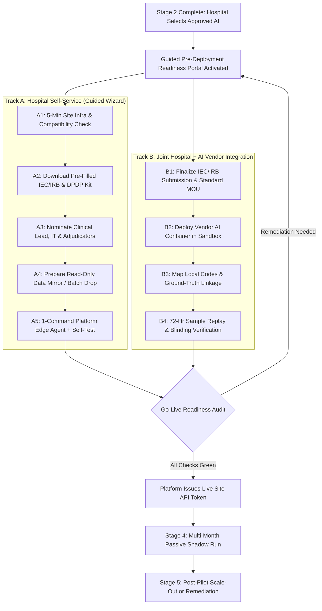

### 3.4 Simplicity-First Prerequisite Split: Self-Service vs. Joint Execution

All core **sandbox integration prerequisites** are completed and verified *before* passive shadow mode switches on, avoiding ad-hoc troubleshooting during the live pilot:

#### Track A: Hospital Self-Service Tasks *(Zero Vendor Dependency — Guided Portal Checklist)*
Hospitals complete these foundational steps at their own pace using turnkey platform kits—often before the first joint technical call:

| # | Self-Service Task | How the Platform Keeps It Simple | Automated Verification |
| :--- | :--- | :--- | :--- |
| **A1** | **Site Readiness & Compatibility Check** | 5-minute guided form (HIS/PACS type, available VM/edge server, network speed) auto-matched against the vendor's listed prerequisites. | Instant Green/Amber fit badge |
| **A2** | **Download Ethics & Privacy Starter Kit** | One-click download of pre-drafted **Passive Shadow IEC/IRB Protocol Template** and **DPDP Act DPIA Checklist** (pre-filled with non-interventional, zero-PHI-egress terms). | Upload receipt / tracking ID in portal |
| **A3** | **Nominate Site Roles** | Assign 1 Clinical Champion, 1 IT/PACS Admin, and 1–2 Blinded Adjudicators via simple email invites in the hospital portal. | Role acceptance confirmed |
| **A4** | **Prepare Read-Only Data Tap (or Drop Zone)** | Follow copy-paste guides to configure a standard read-only PACS auto-route, HL7 mirror, or simple scheduled batch export folder—with **zero write-back permissions**. | Read-only isolation checkbox |
| **A5** | **Install Platform Edge Telemetry Agent** | Run a single Docker Compose / appliance command to deploy the local De-ID & Telemetry Egress Gateway, then click **"Run Self-Test"** in the portal. | Auto-verified mTLS + Zero-PHI test ping |

#### Track B: Joint Hospital + AI Vendor Tasks *(Focused Co-Execution)*
Once Track A is underway or complete, the hospital and AI vendor collaborate only on the four solution-specific integration and governance tasks:

| # | Joint Task | Concrete Sandbox & Governance Scope | Shared Sign-Off |
| :--- | :--- | :--- | :--- |
| **B1** | **Ethics Finalization & Standard MOU** | Add solution-specific clinical background to the hospital's IEC/IRB packet and co-sign the standardized Platform Shadow Pilot MOU. | IEC Approval Letter + Signed MOU uploaded |
| **B2** | **Sandbox AI Deployment & Network Isolation** | Vendor deploys their pre-packaged, security-scanned container into the hospital's prepared sandbox (on-prem VM, edge box, or private VPC) and binds it strictly to the read-only data tap—verified to have **zero outbound route to clinical HIS/PACS write ports**. | Hospital CISO / IT + Vendor DevOps sign-off |
| **B3** | **Local Data & Ground-Truth Mapping** | Jointly map local hospital formats (e.g., site-specific DICOM headers, lab codes, or clinician diagnosis labels) into the shadow sandbox and connect the hospital's confirmed ground-truth source to the local Cross-Check Engine. | Schema mapping test passed |
| **B4** | **72-Hour Dry-Run & Blinding Verification** | Replay 20–50 de-identified historical cases end-to-end through the sandbox; confirm all mandatory Platform Hooks fire cleanly with zero PHI egress, and verify treating clinicians see nothing on live clinical screens. | **Go-Live Readiness Certificate** auto-issued |

---

## 4. The 5-Pillar Monitoring Framework & Criteria Governance

> **Authoritative Criteria Reference:**  
> All detailed evaluation criteria, metric definitions, mathematical formulas, input data sources, computation guides, and category-specific target benchmarks are governed centrally in the **[Evaluation Metrics Explorer — AI Health Solution Evaluations](https://catch-evals.s3.ap-south-1.amazonaws.com/Evaluation_Metrics_Explorer.html)**.  
> To maintain a single, version-controlled source of truth and prevent documentation drift, individual criteria and numeric thresholds are intentionally **not duplicated** in this architecture document.

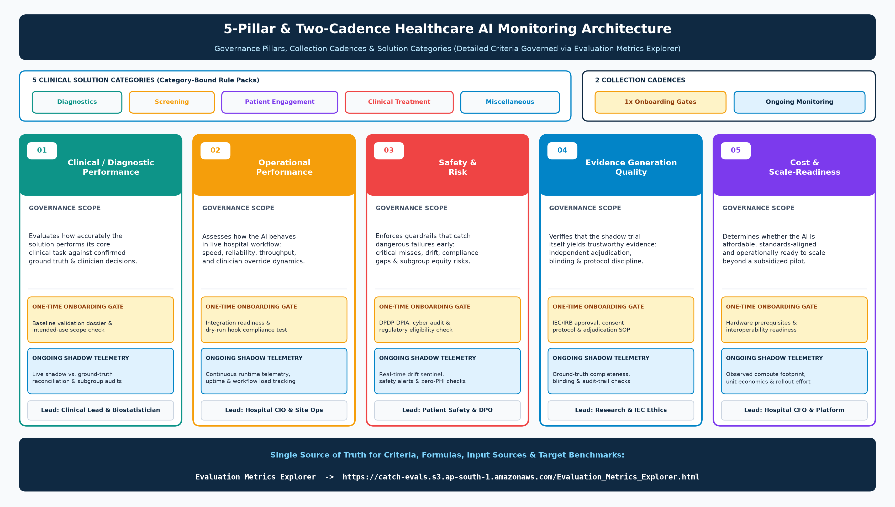

### 4.1 Five-Pillar Governance Architecture
The platform evaluates every shadow pilot holistically across five complementary pillars defined by the Platform Owners:

| Pillar | Governance Purpose & Core Question | Role in Platform Architecture | Primary Governance Lead |
| :--- | :--- | :--- | :--- |
| **1. Clinical / Diagnostic Performance** | *How accurately does the solution perform its core clinical task against confirmed ground truth and existing clinician decisions?* | Continuously computed by reconciling shadow AI outputs with confirmed clinical outcomes and blinded adjudications across patient and site strata. | Clinical Lead & Biostatistician |
| **2. Operational Performance** | *How reliably and smoothly does the solution behave inside live hospital workflows under real clinical load?* | Captured automatically via runtime telemetry hooks and edge agent heartbeats measuring responsiveness, availability, integration stability, and workflow impact. | Hospital CIO & Site Operations Lead |
| **3. Safety & Risk** | *What guardrails catch dangerous failures, drift, equity gaps, or compliance breaches before patients are exposed?* | Monitored in real time by the platform's Safety & Drift Sentinel, triggering automated Amber/Red escalations whenever Explorer safety boundaries are crossed. | Patient Safety Officer & Data Protection Officer |
| **4. Evidence Generation Quality** | *Is the multi-month shadow trial itself producing methodologically rigorous, unbiased, audit-ready evidence?* | Audited continuously through ground-truth linkage tracking, blinding integrity checks, independent adjudication reliability, and protocol discipline telemetry. | Clinical Research Lead & IEC/IRB Representative |
| **5. Cost & Scale-Readiness** | *Is the solution realistically affordable, standards-aligned, and operationally repeatable beyond a subsidized pilot?* | Synthesized from real infrastructure consumption telemetry, onboarding effort timestamps, interoperability checks, and institutional economic inputs. | Hospital CFO & Platform Architecture Lead |

### 4.2 Two-Cadence Evaluation Model (Aligned with Explorer Structure)
Mirroring the structure of the **[Evaluation Metrics Explorer](https://catch-evals.s3.ap-south-1.amazonaws.com/Evaluation_Metrics_Explorer.html)**, the platform enforces criteria across two distinct operational cadences:

1. **One-Time Onboarding Gates (Payload 0 / Package A):**
   - Verified **once prior to pilot activation** during Stage 1 (AI Solution Enlistment) and Stage 3 (Joint Pre-Deployment Gate).
   - Establishes baseline clinical, regulatory, security, ethical, and technical eligibility before any hospital commits operational effort.
2. **Ongoing Performance & Compliance Monitoring:**
   - Collected **continuously or at scheduled audit intervals** throughout Stage 4 (Multi-Month Shadow Pilot) via automated Platform Telemetry Hooks, reconciliation connectors, and periodic adjudication/feedback workflows.
   - Drives real-time dashboards, automated drift/safety alerting, scheduled monthly executive reports, and the final end-of-pilot verdict.

### 4.3 Solution Category Binding
Platform Owners map every enlisted AI solution to one of the five standardized categories defined in the **[Evaluation Metrics Explorer](https://catch-evals.s3.ap-south-1.amazonaws.com/Evaluation_Metrics_Explorer.html)**, automatically binding the corresponding criteria pack, required hook schema, and benchmark thresholds to the pilot workspace:

| Solution Category | Clinical & Operational Scope |
| :--- | :--- |
| **Diagnostics** | Multi-class grading, lesion segmentation, multi-modal fusion, and emergency critical-finding triage. |
| **Screening** | High-throughput population screening and triage across large, predominantly asymptomatic cohorts where case capture and follow-through are paramount. |
| **Patient Engagement** | Clinical visit summarization, multilingual conversational agents, literacy-tiered communication, symptom/PROMs tracking, treatment adherence, and consent-based data vaults. |
| **Clinical Treatment** | Treatment-selection clinical decision support (CDSS), multidisciplinary tumour board (MDT) case workup, and radiotherapy/treatment planning assistance. |
| **Miscellaneous (Ops / Curation / Research)** | Clinical trial matching, imaging de-identification & PACS AI orchestration, and translational operational/surgical decision support. |

### 4.4 How Platform Owners Operationalize Explorer Updates
- **Platform-Wide Inheritance (Zero Per-Solution Governance Rework):** Because governance is established once at Stage 0, onboarding a new AI solution simply binds it to the active version of its category pack—no per-vendor criteria negotiation is needed.
- **Controlled Revision & Version-Pinned Pilots:** Revisions follow the Stage-0 Governance Change-Control Process ([Section 3.1](#31-stage-0-platform-governance-foundation-one-time-prerequisite--revision-process)). When a hospital initiates a multi-month shadow pilot, that pilot locks onto an immutable version of the Explorer criteria pack (e.g., `explorer-pack-v1.x`) so evaluation goalposts remain fair and auditable throughout the run, while future pilots inherit newly ratified revisions.
- **Justification Traceability:** Every rule evaluated by the platform's Rules & Threshold Engine retains a live deep-link back to its official rationale, formula, and computation specification in the **[Evaluation Metrics Explorer](https://catch-evals.s3.ap-south-1.amazonaws.com/Evaluation_Metrics_Explorer.html)**.

---

## 5. Passive Shadow-Mode Execution & Cross-Check Reconciliation Mechanism

The defining design principle of the platform is **Passive Shadow Mode**: clinical care runs with **zero modification and zero patient risk**, while the AI operates silently in the background inside the pre-verified sandbox (configured during Stage 3 prerequisites) and reconciles its outputs asynchronously against real clinician decisions and confirmed ground truth.

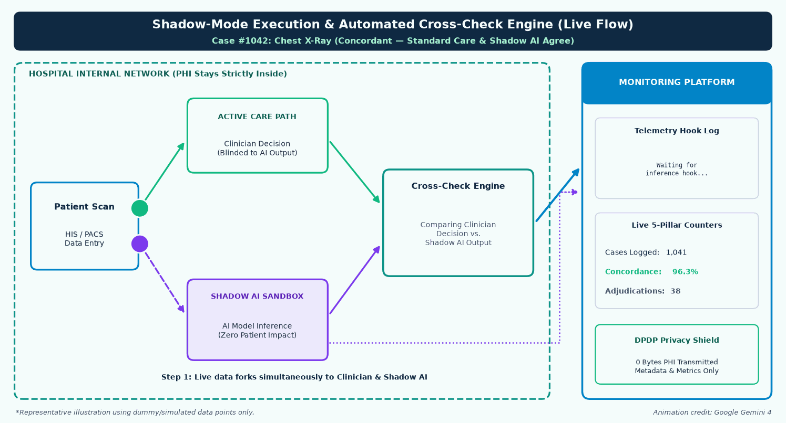  
*Note: Representative visual with dummy/illustrative case values. Animation credit: Google Gemini 4*

### 5.1 How "Passive Shadow Mode" Runs Day-to-Day (Simplicity & Isolation Guarantees)
In practical hospital operations, **Passive Shadow Mode** enforces four simple, non-negotiable guarantees:

1. **Zero Workflow Change for Treating Clinicians:** Doctors, radiologists, nurses, and technicians continue using their existing HIS, EMR, PACS, or LIS interfaces unchanged. Nothing is installed on clinical workstations, no extra clicks are required, and **no AI score, heatmap, or alert is ever displayed** to treating clinicians.
2. **Non-Blocking, Read-Only Data Fork:** Clinical data is copied asynchronously into the Shadow AI Sandbox via a passive read-only mirror. Because the fork is strictly one-way and decoupled, **even if the shadow AI container slows down, crashes, or restarts, hospital clinical systems experience zero latency or downtime.**
3. **Hard Network & Write-Back Isolation:** Firewall rules verified during Stage 3 physically block the Shadow AI Sandbox from writing back to any clinical system or EHR database. Its only permitted outputs are: (a) local storage into the Cross-Check Module, and (b) zero-PHI telemetry hooks routed through the Platform De-ID Egress Gateway.
4. **Tiered Low-Friction Ingestion (Adapts to Every Indian Hospital's IT Maturity):** To keep deployment simple across Tier-1, Tier-2, and Tier-3 facilities, passive shadow mode supports three lightweight ingestion patterns—hospitals simply pick the easiest option that fits their infrastructure:

| Ingestion Tier | Target Hospital Profile | How Passive Data Flows (Zero Clinical Interference) | Integration Complexity |
| :--- | :--- | :--- | :--- |
| **Tier A: Scheduled Batch Drop *(Simplest)*** | Tier-3 District / Small Hospitals without live HL7/FHIR interfaces | Existing system exports a scheduled daily/shift batch (e.g., anonymized scans or CSV/DICOM folder drop) into the local sandbox watch-folder; ground-truth outcomes upload on the same simple cadence. | Very Low *(1–2 days, no live HIS hooks)* |
| **Tier B: Standard Passive Auto-Route *(Default)*** | Tier-2 Regional & Tier-1 Hospitals with PACS / LIS / HIS | Built-in PACS DICOM auto-forwarding rule or read-only HL7 interface mirror automatically sends a silent duplicate copy of every study/result to the sandbox. | Low *(standard hospital IT config)* |
| **Tier C: Real-Time Event Mirror** | Digitally Mature Tier-1 / ABDM-Ready Hospitals | Asynchronous FHIR R4 Subscriptions or message-bus read-only tap streams clinical events in near-real time to the sandbox for low-latency triage evaluation. | Moderate *(reusable FHIR adapter)* |

### 5.2 Cryptographic Pseudonymous Case Linkage
To reconcile AI predictions against downstream clinician decisions and delayed lab/pathology outcomes without ever transmitting patient names or hospital IDs to the central platform:
- The on-premise **Reconciliation Module** computes a site-salted cryptographic token:
  $$\text{case\_token} = \text{HMAC-SHA256}(\text{Site\_Secret\_Salt},\; \text{Accession\_ID} \parallel \text{Encounter\_ID})$$
- The `Site_Secret_Salt` never leaves the hospital firewall.
- Both the Shadow AI inference hook and the later Clinician/Ground-Truth hook reference the exact same `case_token`, enabling lossless time-shifted matching even when confirmatory outcomes arrive days or weeks later.

### 5.3 Four-Quadrant Cross-Check & Blinded Adjudication Protocol
When both the **Shadow AI Prediction** and the **Initial Clinician Decision / Confirmed Ground Truth** are linked, the Cross-Check Engine classifies each case into four buckets:

| Cross-Check Outcome | Initial Clinician | Shadow AI | Automated Platform Action |
| :--- | :--- | :--- | :--- |
| **1. Concordant Positive** | Positive | Positive | Log concordant positive; confirm against delayed gold-standard reference outcome and include in random QA audit sampling. |
| **2. Concordant Negative** | Negative | Negative | Log concordant negative; link follow-up/return encounter hooks where applicable and include in random QA audit sampling. |
| **3. Discordant: AI Alert / Clinician Negative** | Negative | Positive | **Route to Blinded Senior Specialist Adjudication Queue.** Resolves whether the case is an **AI False Alarm** or an **AI Incremental Catch** missed on initial review. |
| **4. Discordant: Clinician Positive / AI Negative** | Positive | Negative | **Priority Safety Adjudication.** If confirmed true positive by reference truth, flags a safety miss and attaches de-identified site/hardware/subgroup metadata for vendor root-cause diagnostics. |

### 5.4 Telemetry Hook & Cross-Check Sequence Diagram

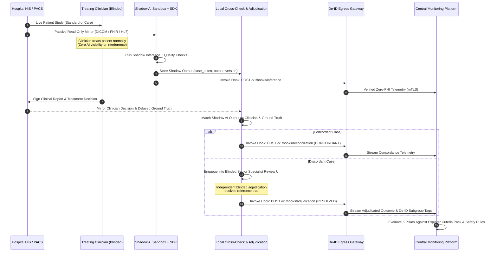

---

## 6. Reference System Architecture & Telemetry Hook Specification

### 6.1 Hybrid Sovereign Architecture
The platform enforces a strict **Two-Zone Security Boundary**:
- **Zone 1 — Hospital Secure Edge Zone (On-Premise / Hospital Private VPC):** Hosts the read-only clinical mirror, containerized Vendor AI Sandbox, Local Cross-Check & Blinded Adjudication UI, and the De-Identification & Telemetry Egress Gateway. **100% of raw PHI, clinical images, and identifiable notes stay inside Zone 1.**
- **Zone 2 — Central Monitoring Platform (India Sovereign Cloud — e.g., MeitY-empaneled region):** Hosts the mTLS API Gateway, Category Schema Validator (bound to the Evaluation Metrics Explorer), Event Streaming Pipeline, 5-Pillar Analytics & Safety Engine, Time-Series/OLAP Warehouse, Automated Executive Report Generator, and the three Stakeholder Portals.

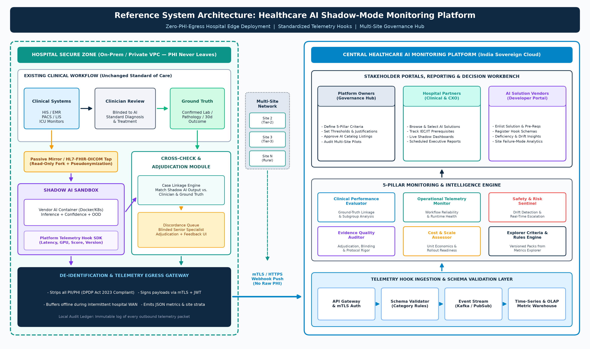

### 6.2 Resilience for Tier-2 and Tier-3 Indian Hospitals
Designed for heterogeneous Indian hospital IT environments:
- **Store-and-Forward Egress Queue:** The local De-ID Egress Gateway persists signed telemetry payloads in an encrypted local ring buffer (supporting multi-week offline buffering) and replays events chronologically once hospital WAN connectivity recovers.
- **Turnkey Container Packaging:** Vendor AI containers and the Platform Telemetry Sidecar deploy via standardized OCI/Docker Compose or lightweight Kubernetes (K3s) manifests with automated pre-flight checks.
- **Automated Zero-PHI Egress Guardrail:** Every outbound JSON payload passes through a strict schema allow-list and automated PII/PHI inspector at the Egress Gateway. Any unexpected free-text or potential identifier (patient name, phone, ABHA/Aadhaar, DOB) is hard-blocked before exiting the hospital network.

### 6.3 Standardized Platform Telemetry Hooks (API Specification)
AI solutions and hospital connectors publish telemetry through five schema-validated webhook endpoints authenticated via mutual TLS (mTLS) and short-lived scoped JWTs. Exact required fields per category are generated dynamically from the **[Evaluation Metrics Explorer](https://catch-evals.s3.ap-south-1.amazonaws.com/Evaluation_Metrics_Explorer.html)** specification:

| Hook Endpoint | Invoker | Cadence | Primary Pillars Fed |
| :--- | :--- | :--- | :--- |
| `POST /v1/hooks/onboarding` | AI Developer / Readiness Portal | One-Time (Payload 0 / Package A) | All 5 Pillars (Pre-Deployment Gates) |
| `POST /v1/hooks/inference` | Vendor Shadow AI SDK | Per case (real-time / micro-batch) | Clinical, Operational, Safety |
| `POST /v1/hooks/reconciliation` | Hospital Cross-Check Module | Upon clinician sign-off & ground-truth arrival | Clinical, Safety, Evidence Quality |
| `POST /v1/hooks/adjudication` | Blinded Adjudication UI | Upon specialist consensus on discordant cases | Clinical, Safety, Evidence Quality |
| `POST /v1/hooks/system-health` | Edge Telemetry Agent | Periodic heartbeats & resource rollups | Operational, Cost & Scale |
| `POST /v1/hooks/user-feedback` | Clinician / Ops Portal | Scheduled & End-of-Pilot structured feedback | Operational, Evidence Quality, Cost & Scale |

#### Illustrative Zero-PHI Webhook Envelope (`POST /v1/hooks/inference`)
```json
{
  "explorer_spec_version": "CATCH-EVAL-DIAGNOSTICS-v1.0",
  "pilot_id": "plt_ind_2026_004",
  "site_id": "hosp_tier3_mh_012",
  "solution_id": "sol_vendor_ai_01",
  "model_version_sha256": "e3b0c44298fc1c149afbf4c8996fb924",
  "case_token": "9f86d081884c7d659a2feaa0c55ad015",
  "event_timestamp_utc": "2026-11-25T09:14:22Z",
  "shadow_output": {
    "predicted_class": "POSITIVE_FINDING",
    "confidence_score": 0.884,
    "abstained": false
  },
  "runtime_envelope": {
    "processing_duration_ms": 2140,
    "connector_protocol": "DICOM_C_STORE",
    "hardware_profile": "EDGE_SINGLE_GPU"
  },
  "deidentified_strata": {
    "age_band": "45-59",
    "sex": "F",
    "care_setting": "OPD",
    "device_oem_group": "LEGACY_CR",
    "hospital_tier": "TIER_3"
  }
}
```

### 6.4 Core Platform Data Model

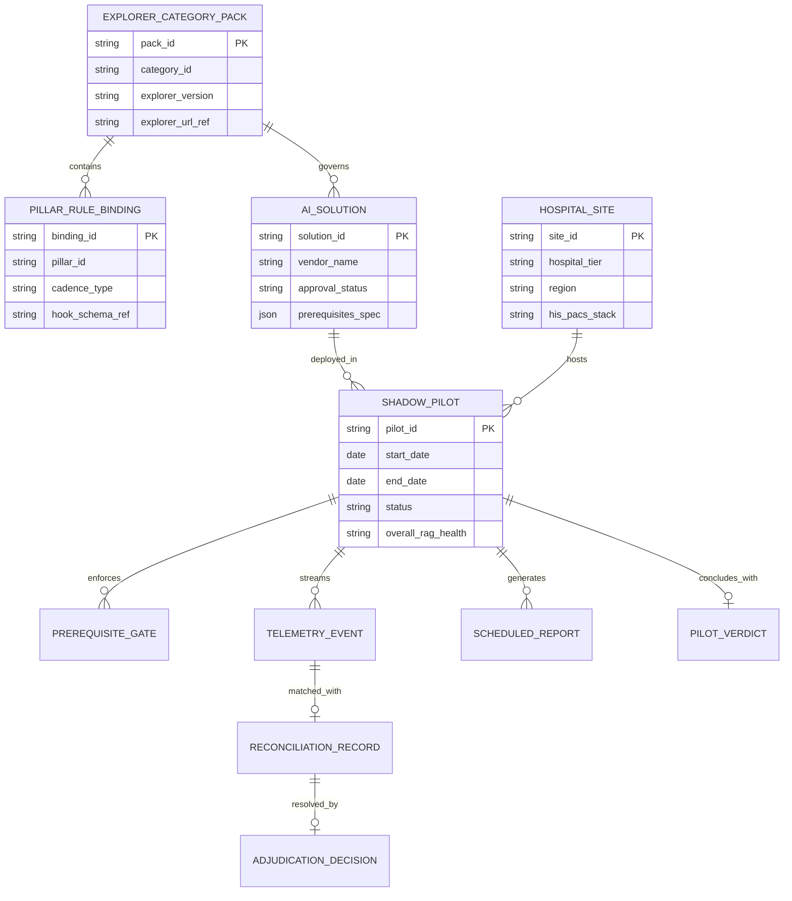

---

## 7. Real-Time Monitoring, Drift Detection & Scheduled Executive Reporting

Multi-month shadow pilots (typically 3 to 6 months) generate continuous telemetry across heterogeneous hospital sites. The platform translates event streams into **real-time operational visibility** and **executive-ready periodic governance reports**.

### 7.1 Role-Based Real-Time Monitoring Dashboards
- **Platform Owners:** Cross-hospital comparative heatmaps, subgroup equity gap tracking, protocol/evidence quality monitors, and category-wide performance curves evaluated against the active Explorer rule-pack.
- **Hospital Leadership & Site Leads:** Live local 5-pillar scorecards, reconciliation backlog, adjudication progress, system availability, and pilot resource consumption.
- **AI Solution Developers:** Scoped diagnostic visibility into error clusters, site-wise distribution shifts, operational latency profiles, and hook health (strictly isolated to their enrolled pilots).

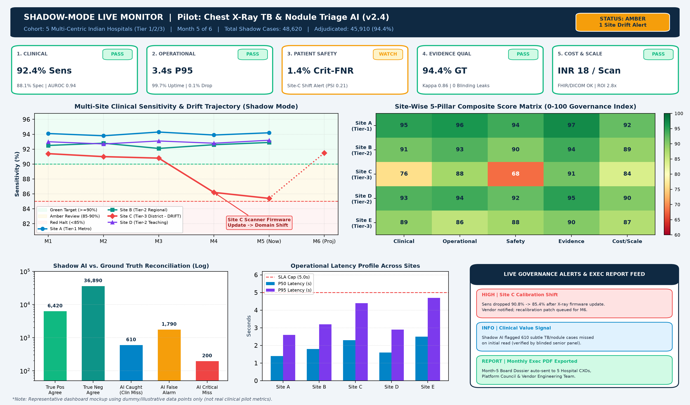  
*Note: Representative dashboard mockup populated with dummy/illustrative data points for visualization purposes only.*

### 7.2 Automated Multi-Month Drift & Safety Sentinel
Running multi-month shadow pilots exposes **temporal and site-specific degradation** that static benchmarks never uncover.

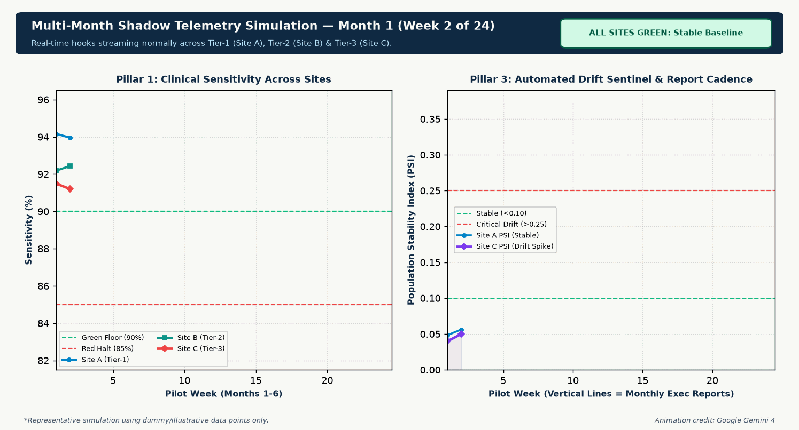  
*Note: Representative simulation using dummy/illustrative telemetry data points. Animation credit: Google Gemini 4*

As illustrated in the simulation above:
1. **Months 1–3 (Stable Baseline):** Participating Tier-1, Tier-2, and Tier-3 sites stream stable baseline telemetry across all five pillars.
2. **Month 4 / Week 13 (Silent Real-World Disruption):** A routine imaging equipment firmware update at Site C (Tier-3 District Hospital) shifts input characteristics—precisely the kind of silent degradation that jeopardizes unmonitored AI in production.
3. **Automated Detection & Escalation (Week 14):** The platform's **Safety & Drift Sentinel** detects the distribution shift and corresponding accuracy decline, automatically escalating Site C to **RED** and notifying Platform Owners, Site C Leads, and the AI Developer.
4. **Controlled Vendor Patch & Recovery (Weeks 19–24):** The AI developer ships a version-tracked preprocessing fix (recorded via updated container hash), restoring Site C within target bounds before Month-6 scale-up review.

### 7.3 Scheduled Executive Reporting Engine
Hospital CXOs, Medical Boards, and Ethics Committees require concise periodic governance summaries without logging into operational consoles daily. The platform automatically compiles and exports signed, audit-stamped PDF/HTML executive packs and structured data appendices:

| Report Tier | Frequency | Primary Recipients | Core Contents |
| :--- | :--- | :--- | :--- |
| **Operational Pulse Digest** | Weekly (Auto-Email / Portal) | Hospital Site Ops, IT Lead, Vendor Support | Hook reliability, integration anomalies, pending ground-truth linkage backlog, unreviewed adjudication queue size. |
| **Executive Governance Dossier** | Monthly (Scheduled PDF Export) | Hospital CXOs, Medical Director, Platform Council, Vendor Leadership | Executive RAG summary across all 5 pillars (benchmarked against the [Evaluation Metrics Explorer](https://catch-evals.s3.ap-south-1.amazonaws.com/Evaluation_Metrics_Explorer.html)), multi-site performance trajectories, top failure/discordance themes, safety/drift incidents, and scale-up readiness trajectory. |
| **Interim Safety Flash Alert** | Event-Driven (Immediate) | Patient Safety Officer, Platform Owners, Site Lead | Triggered automatically upon any critical safety threshold breach, zero-PHI guardrail block, prolonged outage, or blinding breach. |
| **End-of-Pilot Board Package** | Pilot Completion (Frozen Snapshot) | Joint Review Board, Procurement Committee, IEC/IRB | Locked full-cohort 5-pillar statistical analysis, subgroup equity audit, clinician feedback synthesis, economic summary, and formal Scale-Up Recommendation. |

---

## 8. End-of-Pilot Governance, Scale-Up Playbook & Remediation Loop

At the conclusion of the multi-month shadow pilot—once both the **planned pilot duration** and **evidence completeness requirements** defined by the Platform Owners are met—the platform freezes the pilot ledger and transitions into a formal **Post-Pilot Execution Playbook**.

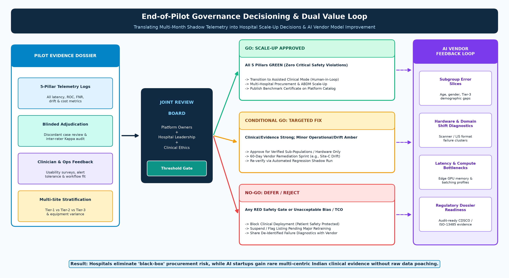

### 8.1 Step 0: Pilot Freeze, Final Adjudication & Joint Review Board
Before any scale-out or decommissioning action occurs, every pilot executes three mandatory closure steps:
1. **Ledger Freeze & Final Adjudication:** Halt intake of new pilot cases into the primary evaluation cohort, close out pending delayed ground-truth confirmations and blinded specialist adjudications, and collect final structured clinician and site-operations feedback.
2. **Evidence Dossier Lock:** Auto-generate the immutable **End-of-Pilot Board Package** scoring observed performance across all five pillars, hospital tiers, and patient subgroups against the version-pinned [Evaluation Metrics Explorer](https://catch-evals.s3.ap-south-1.amazonaws.com/Evaluation_Metrics_Explorer.html) rule-pack.
3. **Joint Review Board Verdict:** Platform Owners, Hospital Leadership, and Clinical Ethics record a signed, auditable determination: **GO (Scale-Out)**, **CONDITIONAL GO (Scoped Rollout + Targeted Fix)**, or **NO-GO (Defer & Rework)**.

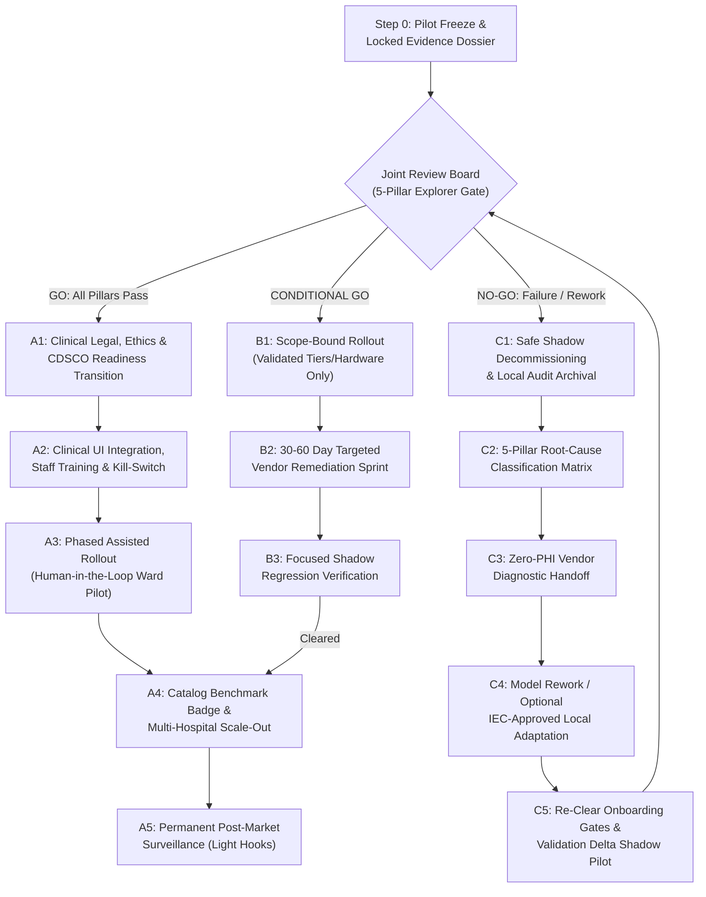

### 8.2 Path A: Ready to Scale Out (`GO` Verdict)
Transitioning from passive shadow mode to live clinical impact follows a **graduated, risk-controlled progression** rather than an abrupt cutover:

| Step | Execution Details | Primary Owners | Exit Deliverable |
| :--- | :--- | :--- | :--- |
| **A1. Regulatory, Ethics & Legal Transition** | Transition from a non-interventional shadow IEC protocol to live clinical deployment governance: verify CDSCO SaMD regulatory status, update clinical liability and indemnity terms, finalize commercial SLAs, and execute procurement pricing anchored to observed pilot unit economics. | Hospital Legal & Procurement, Vendor, Ethics/Compliance | Signed Clinical Deployment Agreement, SLA & Regulatory Sign-Off |
| **A2. Clinical UI Integration, Training & Kill-Switch** | Enable controlled clinical surfacing (e.g., PACS priority worklist flags or EMR decision prompts), train treating clinicians on intended use, known edge cases, and **automation-bias safeguards**, and test a **1-click clinical kill-switch** that instantly reverts to standard workflow. | Hospital IT, Clinical Champions, Vendor | Live Clinical Workflow SOP, Staff Training Sign-Off & Verified Kill-Switch |
| **A3. Phased Assisted Rollout (Human-in-the-Loop)** | Activate live inside **one department, ward, or shift first** (30–60 days) as non-autonomous decision support. Monitor clinician acceptance vs. override rates and real-world workflow impact before expanding hospital-wide. | Clinical Lead, Site Operations | Assisted-Mode Audit & Full-Hospital Activation Approval |
| **A4. Platform Certification & Multi-Site Scale-Out** | Platform Owners issue an audited **Verified Shadow Benchmark Badge** on the catalog (explicitly scoped to validated hospital tiers, clinical categories, and equipment profiles). Sibling and network hospitals reuse the container blueprint, integration playbook, and evidence dossier to compress procurement and site onboarding timelines. | Platform Owners, Expanding Hospitals | Public Catalog Benchmark Certificate & Multi-Site Rollout Playbook |
| **A5. Permanent Post-Market Surveillance (Light Mode)** | **Monitoring never turns off.** Retain lightweight ongoing telemetry hooks in production to detect seasonal or hardware calibration drift, silently failing HIS/PACS feeds, and model-update regressions—automatically requiring shadow re-verification whenever the vendor ships a major model release. | Platform Sentinel, Hospital Ops, Vendor | Continuous Post-Market Safety & Drift Telemetry Stream |

### 8.3 Path B: Partial Success (`CONDITIONAL GO` — Scoped Rollout + Targeted Fix)
Common across heterogeneous Indian hospital cohorts (e.g., strong performance across Tier-1/2 sites with localized degradation on a legacy Tier-3 imaging device or low-bandwidth setup):
1. **Scope-Bound Deployment:** Authorize Path A graduated rollout **strictly for the validated hospital tiers, departments, and hardware profiles** that passed all five pillars.
2. **Time-Boxed Remediation Sprint (30–60 Days):** Issue a structured deficiency ticket to the AI developer isolating the failing slice (e.g., device-specific preprocessing normalization, edge model optimization, or HL7/DICOM parser hardening).
3. **Focused Shadow Regression Run:** Deploy the patched container (logged under a new immutable SHA-256 hash) in shadow mode on the deficient slice until it passes Explorer gates, after which the scope restriction is formally lifted.

### 8.4 Path C: Pilot Failure / Needs Rework (`NO-GO` Verdict)
Because the AI operated strictly in shadow mode, **zero patients were exposed to clinical risk and hospital care remained completely uninterrupted.** Failure triggers clean institutional offboarding paired with a high-precision developer improvement loop:

| Step | Execution Details | Primary Owners | Exit Deliverable |
| :--- | :--- | :--- | :--- |
| **C1. Safe Shadow Decommissioning** | Detach the read-only HIS/PACS data mirror, revoke live site API tokens, purge temporary shadow inference caches, and archive the encrypted telemetry and adjudication ledger locally per IEC/DPDP retention mandates. | Hospital IT, Security / DPO | Decommissioning & Data-Cleanup Certificate |
| **C2. Five-Pillar Root-Cause Classification** | Isolate *why* the pilot failed so rework targets the true bottleneck:<br>• **Clinical / Equity:** Generalization failure, subgroup disparity, or calibration drift.<br>• **Operational:** Latency spikes, brittle HIS/DICOM connectors, or unsustainable alert burden.<br>• **Safety / Drift:** Unacceptable critical misses, poor OOD abstention, or hardware sensitivity.<br>• **Evidence / Protocol:** Hospital-side ground-truth attrition or workflow mismatch (study design issue rather than model flaw).<br>• **Cost / Scale:** Prohibitive infrastructure footprint or non-repeatable integration effort. | Platform Owners, Biostatistician, Clinical Lead | Root-Cause Classification Matrix |
| **C3. Privacy-Preserving Vendor Diagnostic Handoff** | Deliver a structured **Deficiency & Improvement Dossier** containing stratified error clusters (across de-identified age/sex bands, hospital tiers, care settings, and device OEMs), drift timelines, runtime bottlenecks, and clinician usability feedback—**maintaining zero raw PHI egress**. | Platform Owners, Vendor Engineering | De-Identified Failure Diagnostics & Improvement Brief |
| **C4. Vendor Rework & Local Adaptation Options** | AI developer executes targeted remediation (model retraining, calibration tuning, OOD abstention guardrails, compute optimization, or interface hardening). Where Indian demographic or scanner shift requires local adaptation, partner hospitals and vendors may optionally initiate a **separate IEC-approved on-premise or federated fine-tuning protocol** without exporting raw patient data. | AI Developer *(optional: Research Partner Hospitals)* | Updated Release Candidate (Versioned Container + Remediation Changelog) |
| **C5. Catalog Governance & Accelerated Re-Entry** | Flag or temporarily suspend the failed solution version on the catalog so other hospitals do not repeat an unsuccessful deployment. Once reworked, the new release re-clears affected **One-Time Onboarding Gates** and enters a focused **Validation Delta Shadow Pilot** targeting prior failure modes before being reconsidered for full multi-site scale-out. | Platform Owners, AI Developer | Re-Qualification Sign-Off & Re-Entry Shadow Approval |

### 8.5 Strategic Value of the Dual Post-Pilot Loop
- **For Hospitals & Health Systems:** Eliminates irreversible "black-box" procurement commitments and establishes an auditable, continuous clinical safety net from pilot through national scale-out.
- **For AI Solution Developers:** Replaces opaque pilot rejections with independently audited multi-centric clinical evidence (supporting CDSCO SaMD dossiers and commercial RFPs) when ready, or pinpoint engineering diagnostics when rework is required—all without raw multi-center data hoarding.

---

## 9. Regulatory Alignment (India), Risk Register & Phased Implementation Roadmap

### 9.1 Alignment with Indian Healthcare & AI Governance Standards

| Indian Regulatory / Standards Body | Platform Architectural Alignment |
| :--- | :--- |
| **DPDP Act 2023 (Data Protection)** | Zero raw PHI leaves hospital premises; strict purpose limitation; automated egress PHI scanning; local DPIA gate; India sovereign cloud residency. |
| **ICMR Ethical Guidelines for AI in Biomedical Research & Healthcare (2023)** | Mandatory local IEC/IRB approval prior to shadow activation; subgroup equity monitoring; explicit human-oversight and non-interventional shadow safeguards. |
| **CDSCO Medical Device Rules (SaMD)** | Immutable container version hashing, blinded reference adjudication, and complete telemetry lineage produce audit-ready clinical evaluation dossiers. |
| **ABDM / NHA Interoperability Standards** | Readiness checks emphasize FHIR R4, DICOMweb, SNOMED-CT/LOINC, and ABDM health-information-exchange compatibility to support national scale-up. |

### 9.2 Platform Risk Register & Mitigations

| Risk | Severity | Impact | Built-In Platform Mitigation |
| :--- | :---: | :--- | :--- |
| **Accidental Shadow Unblinding** | Critical | Clinicians act on unvalidated AI outputs, risking patient harm and invalidating shadow independence. | Hard network/UI isolation (no write-back ports to HIS/PACS) combined with periodic blinding compliance audits. |
| **Ground-Truth Verification Bias** | High | Selective linkage of only positive or easy cases distorts measured clinical performance. | Explorer-governed Evidence Quality completeness gates plus randomized QA adjudication of concordant negative cases. |
| **Vendor Telemetry Gaming** | High | Vendor manipulates timestamps or silently drops difficult inputs before emitting telemetry hooks. | Independent reconciliation of hospital HIS/PACS encounter totals against AI hook counts; platform-owned Edge Agent timestamps independently. |
| **Multi-Site Comparability Distortion** | Medium | Prevalence and workflow differences across Tier-1 vs. Tier-3 hospitals distort pooled metrics. | Platform always reports site-stratified and tier-stratified views alongside multi-center aggregates. |
| **Hospital IT Resource Fatigue** | Medium | Tier-2/3 hospitals struggle to sustain shadow infrastructure across multi-month pilots. | Turnkey containerized deployment, automated health heartbeats, offline store-and-forward buffering, and vendor-supported integration SLAs. |

### 9.3 Phased Implementation Roadmap

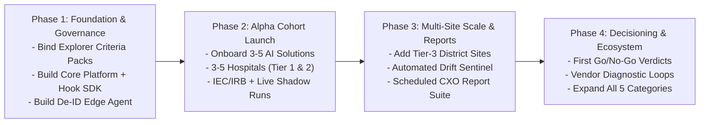

| Phase | Core Deliverables | Exit Milestone |
| :--- | :--- | :--- |
| **Phase 1: Platform Foundation** | Ratify Governance Council (Stage 0); integrate versioned [Evaluation Metrics Explorer](https://catch-evals.s3.ap-south-1.amazonaws.com/Evaluation_Metrics_Explorer.html) criteria packs into the Rules Engine; build Sovereign Central Platform, Hook Ingestion API, Self-Service Readiness Portal, and Hospital De-ID Edge Agent. | End-to-end synthetic shadow run passing security, schema, and zero-PHI penetration tests. |
| **Phase 2: Founding Multi-Centric Cohort** | Onboard 3–5 AI developers (completing One-Time Onboarding Gates); activate 3–5 partner hospitals (Tier-1 & Tier-2); clear self-service & joint IEC/IRB and sandbox mirroring readiness gates. | Live multi-centric passive shadow telemetry streaming with verified zero-PHI egress. |
| **Phase 3: Full Monitoring & Reporting** | Expand to Tier-3 / public-sector sites (including lightweight batch-drop ingestion); activate automated drift sentinel, blinded adjudication workbench, and scheduled CXO Board PDF reporting. | Initial audited multi-tier concordance and operational telemetry dossiers published. |
| **Phase 4: End-of-Pilot Scale-Up & Expansion** | Conduct first Joint Review Board Go/Conditional/No-Go verdicts; execute post-pilot scale-out or vendor remediation playbooks; expand catalog across all 5 Explorer categories. | First cohort transitions safely to assisted clinical rollout backed by multi-centric Indian shadow evidence. |
