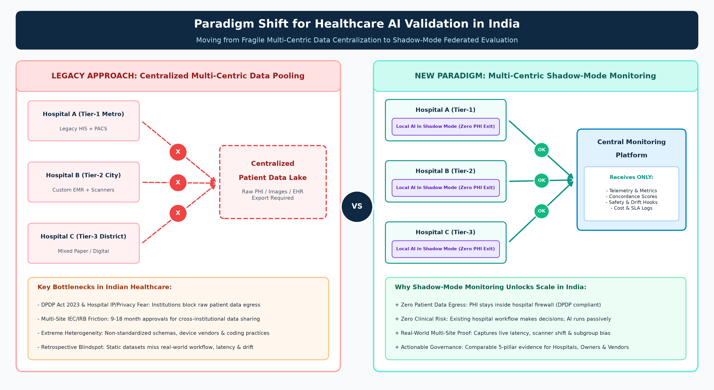
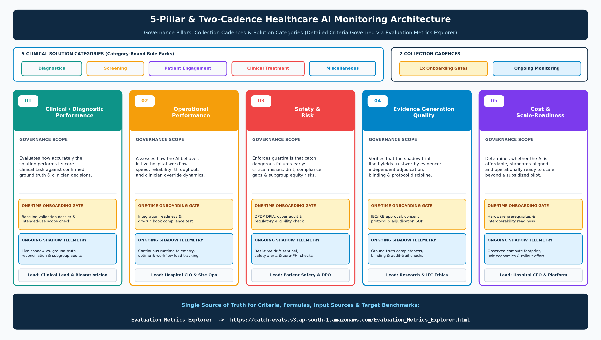

# Clinical AI Shadow-Mode Monitoring Platform
## Executive Brief: De-Risking Multi-Centric Healthcare AI Validation & Scale-Up in India

> **Target Audience:** Hospital CXOs, Medical Directors, Platform Governance Council, Healthcare AI Founders & Policy Stakeholders  
> **Authoritative Criteria Registry:** [Evaluation Metrics Explorer — AI Health Solution Evaluations](https://catch-evals.s3.ap-south-1.amazonaws.com/Evaluation_Metrics_Explorer.html)  
> **Companion Specification:** [Detailed Architecture & Monitoring Framework](./architecture_and_framework.md)  
> **Visual Disclaimer:** All embedded diagrams and linked animations are representative visuals; any figures or charts displayed are dummy/illustrative data points only.

---

<!-- PAGE 1 -->
## Strategic Imperative, Platform Vision & Operating Model

### 1. The Core Problem: India's Dual Bottleneck in Healthcare AI Validation
Scaling clinical Artificial Intelligence across India's diverse healthcare ecosystem—spanning Tier-1 metro super-specialty centers, Tier-2 regional hospitals, and Tier-3 district facilities—is trapped between two flawed validation approaches:

- **Why Centralized Multi-Centric Data Pooling Fails:** Under India's Digital Personal Data Protection (DPDP) Act 2023 and institutional ethics norms, hospitals refuse to export raw patient records or scans to central repositories. Multi-site Institutional Ethics Committee (IEC/IRB) data-sharing approvals routinely take 9–18 months, and static retrospective archives still miss live workflow, latency, and drift realities.
- **Why Isolated Single-Center Pilots Are Sub-Optimal:** Defaulting to one hospital at a time creates equally severe blind spots:
  - *Skewed Measurement of True Gains:* A single site reflects one local disease prevalence, clinician skill baseline, and workflow maturity—making it impossible to separate genuine AI impact from local site quirks or extrapolate ROI elsewhere.
  - *Blindness to Data & Hardware Variability:* One institution exposes the AI to narrow patient demographics, a single HIS/PACS stack, and homogeneous medical devices—hiding cross-site domain shift until after costly rollout.
  - *Duplicated Time, Resources & "Pilotitis":* Running bespoke, sequential single-center pilots forces hospitals and AI startups to repeatedly reinvent criteria, ethics workflows, connectors, and reports from scratch—stretching evidence generation across years while producing non-comparable findings that other hospitals cannot reuse.

### 2. The Proposed Approach: Bring AI to the Hospital in Monitored Shadow Mode
Rather than pooling raw patient data centrally, this platform inverts the model: **deploy healthcare AI solutions directly inside multiple participating hospitals in strictly isolated Shadow Mode, while streaming only standardized, zero-PHI telemetry and performance signals to a neutral central monitoring platform.**

During a multi-month **Passive Shadow Mode** run, **existing hospital systems and clinicians continue delivering 100% of patient care with zero workflow change, zero extra clicks, and zero AI visibility.** Clinical inputs mirror asynchronously via a one-way, non-blocking tap (supporting everything from standard PACS/HL7 auto-forwarding to simple scheduled batch drops for Tier-3 sites) into an isolated local sandbox—so even if the AI pauses or crashes, clinical care is completely unaffected. An on-premise **Cross-Check Engine** then quietly reconciles shadow AI outputs against actual clinician decisions and confirmed ground truth.

### 3. Ecosystem Roles & End-to-End Lifecycle

| Stakeholder Group | Core Platform Responsibilities | Strategic Value Realized |
| :--- | :--- | :--- |
| **Platform Owners** *(Tech Experts, AI Scientists, Researchers, Clinicians)* | Define solution categories, 5-pillar monitoring frameworks, onboarding gates, thresholds, telemetry hook schemas, and clinical justifications via the [Evaluation Metrics Explorer](https://catch-evals.s3.ap-south-1.amazonaws.com/Evaluation_Metrics_Explorer.html); govern catalog approvals and audit pilots. | Establishes an independent, evidence-backed standard for safe clinical AI adoption across India. |
| **Healthcare AI Solution Developers** | Enlist solutions on the catalog with transparent deployment prerequisites (infra, HIS/PACS, ethics templates); complete One-Time Onboarding Gates and integrate mandatory Platform Telemetry Hooks. | Gains rapid multi-centric real-world validation and granular failure/drift diagnostics without raw data hoarding. |
| **Hospitals & Clinical Institutions** | Browse approved AI solutions matching local clinical priorities; partner with vendors on IEC/IRB & IT readiness; run zero-risk shadow pilots; review live dashboards & executive reports. | Eliminates "black-box" procurement risk; proves clinical, operational, and economic fit before any live clinical rollout. |

**Platform Foundation & Repeatable Pilot Lifecycle** *(see animated walkthrough: [End-to-End Platform Lifecycle](./animations/end_to_end_platform_lifecycle.gif) — Animation credit: Google Gemini 4)*:
- **Stage 0 — Platform Governance Foundation *(One-Time Platform Prerequisite + Periodic Revision)*:** Established **once** by Platform Owners—never repeated per AI solution. Defines the 5-pillar framework, category rule-packs, onboarding gates, and hook schemas in the [Evaluation Metrics Explorer](https://catch-evals.s3.ap-south-1.amazonaws.com/Evaluation_Metrics_Explorer.html), governed by a formal **Change-Control Revision Process** to update standards as regulations, clinical evidence, or cross-pilot learnings evolve (with active pilots version-pinned).
- **Repeatable Per-Solution / Per-Pilot Lifecycle (Stages 1–5):**
  1. **Solution Enlistment:** AI Vendors map their solution to an existing Stage-0 category pack, declare site prerequisites, clear one-time intake gates, and integrate Telemetry Hooks.
  2. **Hospital Selection:** Clinical institutions choose vetted AI solutions suited to their specialty, patient population, and IT maturity.
  3. **Simple Readiness & Sandbox Gate *(Self-Service + Joint)*:** Hospitals independently complete self-service prerequisites via a guided portal (infra check, pre-filled IEC/IRB & DPDP kits, 1-command Edge Agent install, read-only data tap), then jointly with the vendor deploy the isolated AI sandbox, map local codes, and clear a 72-hour dry-run test.
  4. **Multi-Month Passive Shadow Run:** AI executes silently and non-blockingly alongside standard care; automated hooks stream ongoing telemetry, cross-check concordance, and scheduled executive reports.
  5. **Post-Pilot Decisioning:** End-of-pilot telemetry, adjudicated outcomes, and clinician feedback drive formal **Go / Conditional-Go / No-Go** scale-out or rework pathways (and optionally feed systemic insights back into Stage-0 governance revisions).

---

<!-- PAGE 2 -->
## The 5-Pillar Governance Framework, Telemetry & Business Impact

### 4. Five-Pillar Monitoring Architecture (Criteria Governed Externally)
Every shadow pilot is evaluated across **five governance pillars**, tailored to five clinical solution categories (**Diagnostics**, **Screening**, **Patient Engagement**, **Clinical Treatment**, and **Miscellaneous**) and split across two collection cadences: **One-Time Onboarding Gates (Payload 0)** and **Ongoing Performance & Compliance Monitoring**.

> **Single Source of Truth for Criteria & Thresholds:** To avoid duplicating or diverging from versioned governance standards, individual evaluation criteria, mathematical formulas, input sources, computation methods, and target thresholds are **not enumerated in this brief**. Please refer directly to the live **[Evaluation Metrics Explorer](https://catch-evals.s3.ap-south-1.amazonaws.com/Evaluation_Metrics_Explorer.html)** maintained by the Platform Owners.

| Monitoring Pillar | Governance Scope & Core Objective | Cadence Coverage | Executive Justification |
| :--- | :--- | :--- | :--- |
| **1. Clinical / Diagnostic Performance** | Assesses how accurately the AI performs its core clinical task against confirmed ground truth and clinician decisions. | Ongoing Monitoring & Periodic Audit | Proves real-world diagnostic effectiveness across diverse Indian cohorts and facility tiers. |
| **2. Operational Performance** | Evaluates how the solution behaves inside live hospital workflows—speed, reliability, throughput, and override dynamics. | Onboarding Check + Ongoing Telemetry | Ensures operational viability inside constrained hospital IT settings without disrupting clinicians. |
| **3. Safety & Risk** | Enforces guardrails that detect hazardous failures early—critical misses, drift, regulatory gaps, and subgroup inequities. | Onboarding Gate + Real-Time Sentinel | Surfaces silent failures and clinical hazards *before* patients are ever exposed to AI outputs. |
| **4. Evidence Generation Quality** | Verifies that the shadow pilot itself generates trustworthy evidence via independent adjudication, blinding, consent, and protocol discipline. | Onboarding Gate + Continuous Audit | Ensures pilot findings meet evidentiary rigor for Hospital Boards, CDSCO/ICMR review, and publications. |
| **5. Cost & Scale-Readiness** | Assesses real-world affordability, infrastructure footprint, interoperability, and operational repeatability beyond a subsidized pilot. | Onboarding Baseline + Pilot Economics | Validates financial sustainability and multi-hospital rollout readiness across public and private networks. |

### 5. Real-Time Visibility, Cross-Checking & Scheduled Executive Reporting
Throughout the multi-month shadow run (typically 3–6 months):
- **Automated Cross-Checking:** Every shadow AI prediction is cryptographically linked (via pseudonymous site tokens) to the clinician's independent decision and final confirmed ground truth. Discordant cases automatically enter a **Blinded Senior Specialist Adjudication Queue**, cleanly separating AI errors from cases where AI identified subtle findings missed on initial review *(see [Shadow-Mode Live Flow Animation](./animations/shadow_mode_data_flow.gif) — Animation credit: Google Gemini 4)*.
- **Live Safety & Drift Oversight:** Real-time dashboards track multi-site pillar health and surface site-specific shifts early (e.g., hardware/firmware calibration drift at a Tier-3 site—see [Multi-Month Drift Simulation](./animations/multi_month_telemetry_drift.gif) — *Animation credit: Google Gemini 4*).
- **Scheduled Executive Reports:** Automated weekly site digests and monthly Board/CXO PDF dossiers summarize RAG status across all five pillars, top discordance themes, and scale-up trajectory without manual analyst compilation.

### 6. Post-Pilot Pathways: Graduated Scale-Out vs. Structured Rework
At pilot completion, the platform freezes the telemetry ledger, completes final blinded adjudications, and convenes the **Joint Review Board** (Platform Owners, Hospital Leadership, and Clinical Ethics) to execute one of two operational pathways (plus a hybrid **Conditional-Go** path for scoped rollouts alongside 30–60 day targeted fixes):

| Post-Pilot Outcome | Structured Next Steps | Strategic Impact |
| :--- | :--- | :--- |
| **Ready to Scale Out (`GO`)** | 1. **Governance & Contracting:** Transition from shadow IEC to live clinical/CDSCO governance, SLAs & pilot-proven unit pricing. 2. **Graduated Assisted Launch:** Enable clinical UI integration with staff training and a 1-click kill-switch in one ward/department first (Human-in-the-Loop). 3. **Network Scale-Out & Surveillance:** Publish a scoped **Verified Benchmark Badge** to accelerate sibling-hospital onboarding while keeping lightweight post-market drift hooks permanently active. | Converts verified shadow evidence into safe, repeatable multi-hospital scale-up with continuous drift protection. |
| **Failure / Rework Needed (`NO-GO`)** | 1. **Safe Decommissioning:** Detach read-only HIS/PACS mirrors, revoke tokens, and archive audit logs locally (zero clinical harm occurred). 2. **Root-Cause & Zero-PHI Diagnostics:** Classify 5-pillar failure modes and hand off stratified error, hardware-shift, and operational diagnostics to the vendor (no raw PHI egress). 3. **Rework & Accelerated Re-Entry:** Flag failed version on catalog; vendor remediates (or executes separate IEC-approved local/federated adaptation), re-clears affected onboarding gates, and runs a focused **Validation Delta Shadow Pilot**. | Protects patients from unsafe AI while giving developers pinpoint multi-centric engineering feedback to improve. |

